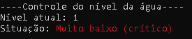
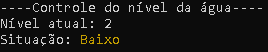
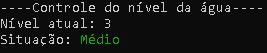
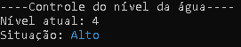
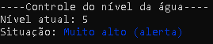

# 💧 Programa Teste para Controle de Níveis de Água

   

Programa teste desenvolvido em Python para **simular o nível de água de um reservatório** e exibir no terminal a situação correspondente, destacada com uma cor específica por meio da biblioteca **Colorama**.<br>

O nível é definido aleatoriamente a cada execução, sem necessidade de informar dados. O programa não realiza medições reais do reservatório.<br>

Ao executar, o terminal apresenta:
* Nível atual do reservatório, de 1 a 5
* Situação correspondente ao nível
* Mensagem destacada com a cor definida para a situação

## 🌊 Níveis do Reservatório

| Nível | Situação | Cor |
|---|---|---|
| 1 | Muito baixo (crítico) | Vermelho |
| 2 | Baixo | Amarelo |
| 3 | Médio | Verde |
| 4 | Alto | Ciano |
| 5 | Muito alto (alerta) | Azul |

## ⚙️ Funcionamento

* As situações e as respectivas cores são armazenadas em uma **lista aninhada**.
* A função `randint(0, 4)` sorteia o índice de um dos cinco níveis.
* A função `exibir_situacao()` identifica a mensagem e a cor correspondentes ao nível sorteado e apresenta o resultado no terminal.
* Após a mensagem, `Style.RESET_ALL` restaura o estilo padrão do terminal.

## 🧪 Testes de Execução

### Nível 1 - Muito baixo (crítico)


### Nível 2 - Baixo


### Nível 3 - Médio


### Nível 4 - Alto


### Nível 5 - Muito alto (alerta)

  
## ▶ Como executar

* Certifique-se de ter o **Python** instalado no computador.
* Instale a biblioteca Colorama pelo terminal, caso ainda não esteja instalada:

  ```bash
  pip install colorama
  ```

* Abra a pasta do projeto em um terminal.
* Execute o arquivo `app.py` utilizando o comando:

  ```bash
  python app.py
  ```

* O programa exibirá um nível aleatório e sua situação correspondente. Execute-o novamente para realizar outra simulação.
